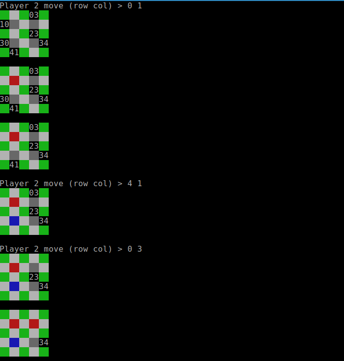
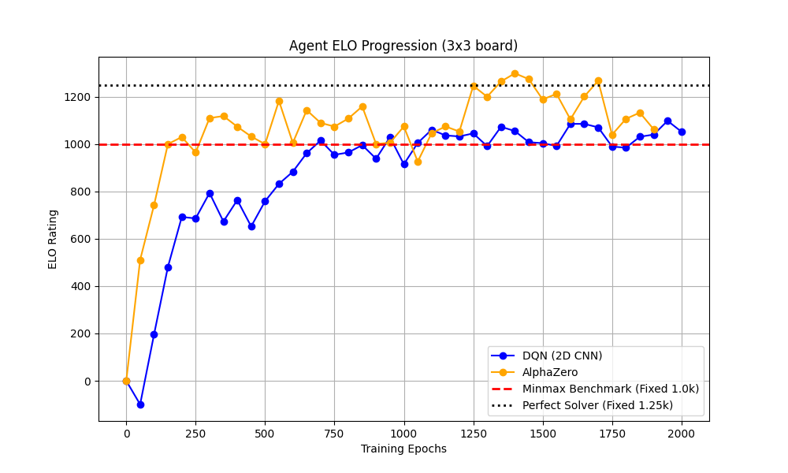

# DotGame: Reinforcement Learning Agents for Dots & Boxes

Implemented deep reinforcement learning architectures to solve the combinatorial space of Dots and Boxes. 

## 🤖 Implemented Decision Agents
The codebase exposes highly modular training backends (`/agents`) to pit classic search frameworks against deep policy networks:
* **`alphazero.py` (AlphaZero-style):** Deep neural network architecture combining Convolutional policy/value evaluation heads inside a generalized Monte Carlo Tree Search (MCTS) rollout loop.
* **`mcts.py` (Pure MCTS):** Stochastic heuristic rollouts balancing exploration/exploitation metrics across raw board spaces.
* **`minmax.py` (Classical Minimax):** Exhaustive tree lookups serving as an exact deterministic performance baseline on low-dimensional boards ($2\times2$ to $5\times5$).
* **`dqn.py` (Deep Q-Networks):** Continuous state space values mapping action selections through custom deep multi-layer neural architectures.
* **`tabular_q.py` (Tabular Q-Learning):** Discrete mapping for tracking small, bounded sub-states.





---



---


## Directory Structure

DotGame/<br/>
├── agents/ #All agent implementations<br/>
├── env/ #DotGame environment<br/>
├── legacy/ #Old C implementation<br/>
├── trained_models/ #Saved model files<br/>
├── plots/ #Plots saved here after play<br/>
├── train.py #Main training entry point<br/>
├── play.py #Main evaluation entry point<br/>
├── requirements.txt #Libraries used<br/>
└── README.md #This file<br/>


---


## Usage

### Install dependencies
```bash
pip install -r requirements.txt
```

### Train an agent

```bash
python3 -m train --dots 3 --agent mcts --epochs 400000
```

Supported agents: qt, dqn, mcts, alphazero

### Play bw agents

```bash
python3 -m play --dots 4 --agent1 self --agent2 alphazero --games 1
```

self = user input<br/>
win-loss rate would automatically be plotted after games at plots/


---


Legacy: legacy/dotgame.c

```bash
gcc dotgame.c
./a.out
```
